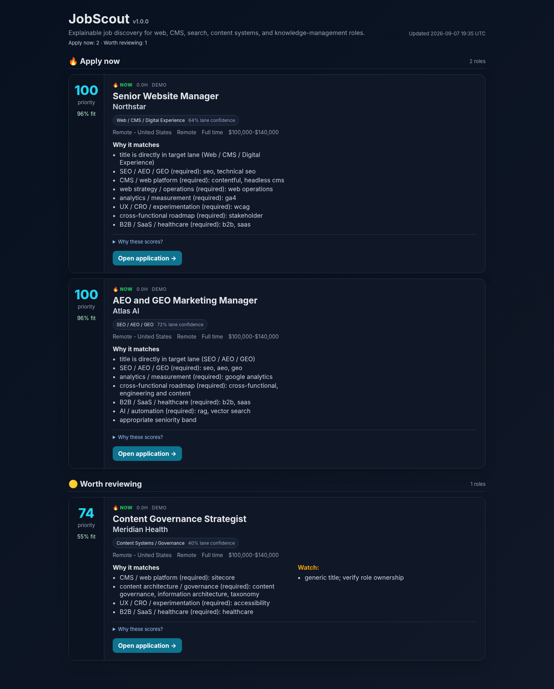
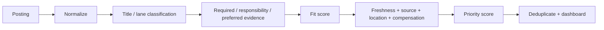

# JobScout

**Explainable, local-first job discovery and ranking across public ATS and remote-job feeds.**

  

JobScout started as a practical answer to a noisy job search: ingest thousands of postings, reject obvious mismatches early, and surface a small set of roles with an auditable explanation of **why** they are worth reviewing.

It is intentionally not a black-box recommendation model. The engine normalizes postings from multiple ATS platforms, classifies each role into a career lane, weights evidence by job-description section, separates **fit** from **application priority**, and records every scoring contribution.



## Why this project is interesting

A job title is not enough to determine fit, and keyword counting is surprisingly easy to fool. Early prototypes produced false positives when `GEO` meant *geospatial*, `CRO` meant *Chief Revenue Officer*, or a finance role happened to mention “governance” and “stakeholders.” JobScout treats those failures as test cases rather than one-off exceptions.

The result is a small information-retrieval system with four distinct concerns:

1. **Retrieval** — public ATS and remote-job adapters.
2. **Normalization** — one source-independent `Job` model.
3. **Classification and ranking** — deterministic, requirement-aware evidence.
4. **Auditability** — dashboards, CSVs, rejected-role reasons, and source health.

## Highlights

- **11 source adapters:** Greenhouse, Ashby, Lever, SmartRecruiters, Workday, iCIMS, Stripe Careers, Remote OK, Jobicy, Himalayas, and We Work Remotely.
- **Two-stage ranking:** career-lane classification before fit scoring.
- **Requirement-aware evidence:** Required Qualifications count more than Responsibilities, Preferred Qualifications, or general boilerplate.
- **Context-aware acronyms:** suppresses common `GEO` and `CRO` false positives.
- **Fit ≠ priority:** freshness, source authority, geography, compensation, and contract preference affect priority without rewriting fit.
- **Cross-source deduplication:** fuzzy title matching, company canonicalization, and direct-employer preference.
- **Explainable dashboard:** every result exposes fit evidence, priority evidence, risks, lane confidence, and alternate sources.
- **Audit outputs:** eligible, rejected, near-miss, and alert records.
- **Local-first:** no database or cloud account required.
- **Zero runtime dependencies:** Python standard library only.

## Quick start

```bash
git clone https://github.com/thekylemurray/jobscout.git
cd jobscout
python -m venv .venv
```

Activate the environment, then install JobScout:

```bash
python -m pip install -e .
```

Create your local configuration:

```bash
jobscout init
```

Then edit `config.json` to set your local regions and source boards. Validate it:

```bash
jobscout doctor
```

Run one scan and open the dashboard:

```bash
jobscout scan --open
```

Or generate a completely offline synthetic demo:

```bash
jobscout demo --open
```

## CLI

```text
jobscout init [--force]
jobscout scan [--open] [--quiet]
jobscout watch
jobscout demo [--open]
jobscout doctor
```

Use `--home PATH` when you want runtime state somewhere other than the current directory.

## Output

A live scan writes:

```text
output/
├── jobs.html          # ranked dashboard
├── jobs.csv           # dashboard-visible roles
├── eligible_all.csv   # all eligible matches
├── near_miss.csv      # useful rejected edge cases
├── rejected.csv       # full rejection audit
├── new_matches.json   # newly alertable roles
└── last_run.log       # source health + rejection summary
```

Runtime files are ignored by Git.

## Phase 1 — application trust (CLI preview)

The personal CLI can now check high-priority employer application pages before recommending them, label the reliability of posting dates, and retain requisition history across repeated scans. Closed posts are excluded; blocked, JavaScript-only, and otherwise uncertain postings remain reviewable rather than falsely classified as closed. Automatic alerts require a recent direct-employer timestamp and a confirmed accessible application. See [Phase 1 trust checks](docs/TRUST_PHASE1.md) for the precise rules and limitations.

## Scoring at a glance

JobScout first asks: **what kind of job is this?** Only after a coherent lane is established does it score evidence.



The bundled profile targets web/CMS/digital-experience, SEO/AEO/GEO, content systems/governance, knowledge management, marketing operations, and adjacent communications roles. See [Scoring model](docs/SCORING.md) for the rationale and weights.

For a short history of how false positives became regression tests, see [Calibration notes](docs/CALIBRATION.md).

## Example production behavior

During one calibration run of the prototype, JobScout processed more than ten thousand rejected postings across 75 healthy configured sources and reduced the review set to roughly fifty dashboard roles. The important metric was not raw volume; it was that false positives became explicit regression tests and ranking changes became explainable.

## Repository structure

```text
JobScout/
├── .github/workflows/ci.yml
├── docs/
│   ├── ARCHITECTURE.md
│   ├── CALIBRATION.md
│   ├── SCORING.md
│   └── SOURCES.md
├── examples/
│   └── config.full.json
├── src/jobscout/
│   ├── app.py
│   ├── cli.py
│   ├── demo.py
│   ├── http.py
│   ├── models.py
│   ├── paths.py
│   ├── rules.py
│   ├── scoring.py
│   ├── sources.py
│   └── utils.py
├── tests/
├── config.example.json
└── pyproject.toml
```

## Engineering decisions

**Why not just embeddings?** A semantic model would be a useful later-stage reranker, but the first problem was precision and debuggability. Deterministic evidence gives each ranking decision a provenance trail and makes regressions cheap to test.

**Why local state?** A personal search tool does not need infrastructure to be useful. JSON state and CSV exports keep the project easy to inspect, portable, and privacy-conscious.

**Why direct ATS preference?** Aggregators are excellent for discovery, but employer ATS records are generally better canonical sources for application links and structured metadata.

## Development

```bash
python -m pip install -e ".[dev]"
ruff check src tests
pytest
```

CI runs the regression suite on Python 3.11, 3.12, and 3.13. Ruff is included as an optional local development check.

## Roadmap

- Feedback states (`apply`, `pass`, `applied`, `interview`) and preference learning.
- Pluggable career profiles instead of one bundled web/content/search profile.
- Optional semantic reranking after deterministic filtering.
- Source-specific health telemetry and fixture-backed adapter tests.
- Salary normalization across hourly, monthly, and annual ranges.
- Optional SQLite persistence for longer search histories.

## Responsible use

JobScout reads public job-posting endpoints. Public interfaces and terms can change; configure reasonable scan intervals and respect each site's terms and rate limits. It does not submit applications or bypass access controls.

## License

MIT. See [LICENSE](LICENSE).
