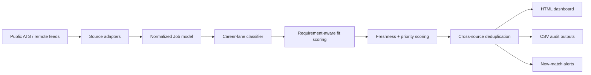

# Architecture

JobScout is a local-first pipeline with deterministic, inspectable ranking.

## Modules

- `sources.py` — source-specific retrieval and normalization.
- `models.py` — normalized `Job` dataclass.
- `utils.py` — text normalization, contextual acronym matching, date parsing, section extraction.
- `scoring.py` — classification, fit, geography, freshness, priority, and deduplication.
- `app.py` — orchestration, audit exports, dashboard rendering, notifications.
- `cli.py` — cross-platform command-line interface.

## Design constraints

1. **Explainability over black-box ranking.** Every positive and negative score contribution is preserved.
2. **Source normalization before ranking.** Adapters map vendor-specific payloads into one model.
3. **Local-first state.** Search history and detail caches stay on disk and are excluded from Git.
4. **No runtime dependencies.** The scanner uses Python's standard library; `pytest` and `ruff` are development-only.
5. **Auditability.** Eligible, rejected, near-miss, and alert records are all exportable.
